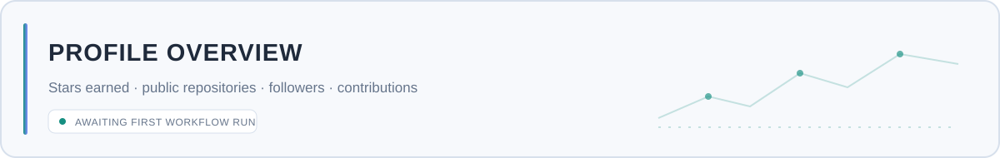
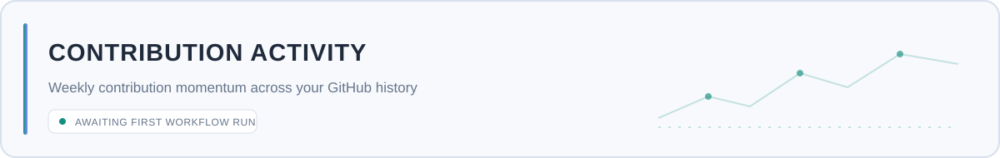
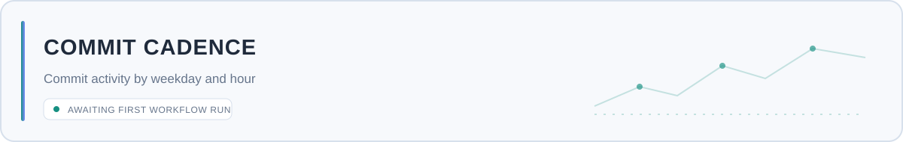

<!--
  GitHub Profile README
  Username: souravhossanofficial-cmd
  Theme: Aesthetic Deep Cyberpunk / Glassmorphic Tech Cyan
-->

<!-- VISUAL HEADER BANNER & TYPING ANIMATION -->

  

<!-- SOCIAL & CONTACT BADGES -->

  
  &nbsp;
  
  &nbsp;
  

  <code>⚡ QUANTITATIVE DEVELOPMENT</code> &nbsp;
  <code>📈 FINTECH ENGINEERING</code> &nbsp;
  <code>⚡ ALGORITHMIC SYSTEMS</code> &nbsp;
  <code>🤖 AI INTEGRATION</code>

---

## ⚡ About Me

I am **MD Sourav Hossan**, a Quantitative Systems Architect and FinTech Engineer dedicated to engineering ultra-low latency financial tools, automated investment engines, and scalable data pipelines. My work bridges timeless value-investing strategies (Greenblatt, McKinsey DCF, EVA) with modern real-time streaming architectures and AI integrations.

- 🔭 **Current Focus:** Building and expanding the [**Quant Investment Suite**](https://github.com/souravhossanofficial-cmd/quant-investment-suite)
- 🌱 **Currently Learning:** Advanced AI Integration in FinTech & High-Frequency Microstructure Analytics
- 🤝 **Collaboration:** Open to quantitative finance, algorithmic trading engines, and core FinTech engineering
- 📫 **Contact:** [souravhossan.official@gmail.com](mailto:souravhossan.official@gmail.com)

---

## 💎 Featured Flagship Project

<table>
  <tr>
    <td>
      <h3 align="left">
        <a href="https://github.com/souravhossanofficial-cmd/quant-investment-suite">
          ⚡ Quant Investment Suite (Institutional Real-Time Dashboard)
        </a>
      </h3>
      

        An institutional-grade real-time financial dashboard and quantitative engine featuring sub-second market streaming, dynamic company-to-ticker resolution, and 3D glassmorphic analytics.
      

      

        <b>Core Financial & Risk Modules:</b> 
        • <b>Greenblatt's Magic Formula Screener:</b> Multi-factor ranking (Earnings Yield & ROC) with automatic sector exclusions. 
        • <b>McKinsey Key Value Driver DCF:</b> Dynamic enterprise valuation linked to RONIC, WACC, and perpetuity growth with 3D surface sensitivity charts. 
        • <b>EVA & Economic Profitability:</b> Economic spread diagnostics and shareholder value calculation. 
        • <b>Momentum Filter Rules & Kelly Criterion:</b> Trend-following scanner and optimal fractional capital allocation sizing.
      

      

        <code>Python</code> · <code>Streamlit</code> · <code>yfinance</code> · <code>Plotly 3D</code> · <code>ThreadPoolExecutor</code> · <code>Apache 2.0</code>
      

      

        <a href="https://github.com/souravhossanofficial-cmd/quant-investment-suite"><b>View Repository →</b></a>
      

    </td>
  </tr>
</table>

---

## 🛠️ Technology & Skill Matrix

  <!-- Quantitative & FinTech -->
  
  
  
  
  
  
   
  <!-- Web & Infrastructure -->
  
  
  
  
  
  

  
🔍 <strong>Full Technology Stack Breakdown (Text Version)</strong>

  - **Quantitative & Data:** Python, C++, Pandas, NumPy, Plotly, SciPy, CanvasJS, Chart.js, D3.js
  - **Frameworks & Web:** Streamlit, FastAPI, Flask, Node.js, Express, React, Flutter, .NET, Spring
  - **Infrastructure & Cloud:** AWS, Azure, GCP, Docker, Git, Linux CLI, Bash, RabbitMQ, Grafana
  - **Databases:** PostgreSQL, MS SQL Server, MySQL, Oracle

---

## 🐍 Interactive Contribution Animation

  

---

## 📊 Live GitHub Analytics & Overview

  
  

  

---

## 📈 Activity & Commit Momentum

  

---

## 📈 Activity & Commit Momentum

  

---

## 📈 Activity & Commit Momentum

  

  
🖼️ <b>View Rendered Local Telemetry Cards</b>

   
  

    <picture>
      <source media="(prefers-color-scheme: dark)" srcset="./assets/overview.dark.svg" />
      
    </picture>
  

  

    <picture>
      <source media="(prefers-color-scheme: dark)" srcset="./assets/momentum.dark.svg" />
      
    </picture>
  

  

    <picture>
      <source media="(prefers-color-scheme: dark)" srcset="./assets/cadence.dark.svg" />
      
    </picture>
  

---

<!-- FOOTER BANNER WAVE -->

  

  ⚡ Built with mathematical rigor, clean engineering, and institutional focus.

