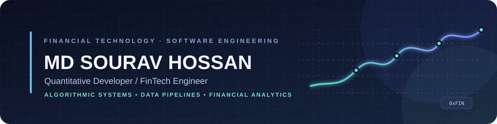
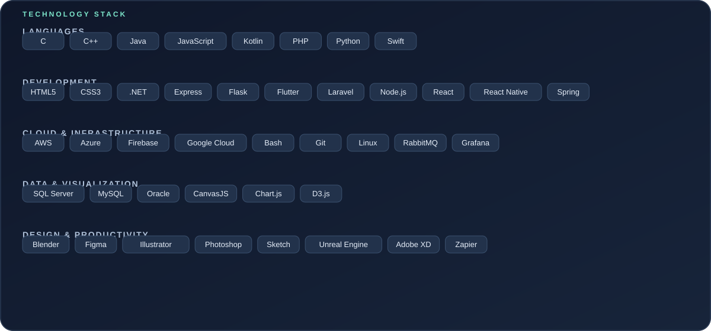
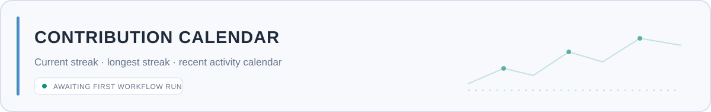
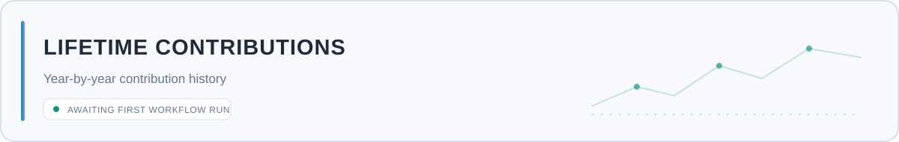
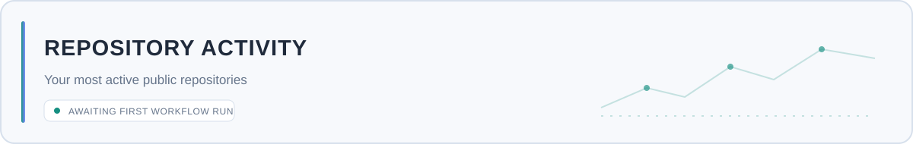
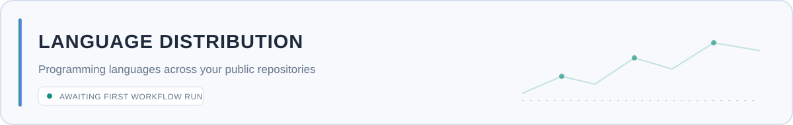

<!--
  GitHub Profile README
  Username: souravhossanofficial-cmd
  Analytics SVGs are generated locally in this repository by:
  .github/workflows/profile-cards.yml
-->

  

  <a href="https://github.com/souravhossanofficial-cmd">GitHub</a>
  &nbsp;·&nbsp;
  <a href="https://x.com/souravhossan3">X</a>
  &nbsp;·&nbsp;
  <a href="mailto:souravhossan.official@gmail.com">Email</a>

  <code>QUANTITATIVE DEVELOPMENT</code>
  &nbsp; <code>FINTECH</code>
  &nbsp; <code>ALGORITHMIC SYSTEMS</code>
  &nbsp; <code>AI INTEGRATION</code>

---

## About

I’m **MD Sourav Hossan**, focused on building algorithmic investment systems, real-time data pipelines, and financial analytics solutions. I’m currently exploring **advanced AI integration in FinTech** and developing the **Quant Investment Suite**.

- 🔭 **Current focus:** [quant-investment-suite](https://github.com/souravhossanofficial-cmd/quant-investment-suite)
- 🌱 **Currently learning:** Advanced AI integration in FinTech
- 🤝 **Collaboration:** Open to discussing quantitative development, FinTech engineering, and financial analytics
- 💬 **Topics:** Quantitative development · FinTech engineering · Algorithmic systems
- 📫 **Contact:** [souravhossan.official@gmail.com](mailto:souravhossan.official@gmail.com)

## Featured project

<table>
  <tr>
    <td>
      <h3><a href="https://github.com/souravhossanofficial-cmd/quant-investment-suite">◈ Quant Investment Suite</a></h3>
      
My current development focus. Follow the repository for source updates, implementation progress, and future releases.

      
<a href="https://github.com/souravhossanofficial-cmd/quant-investment-suite">View repository →</a>

    </td>
  </tr>
</table>

## Technology & tools

  

  
<strong>Technology list (text version)</strong>

  - **Languages:** C, C++, Java, JavaScript, Kotlin, PHP, Python, Swift
  - **Web & application development:** HTML5, CSS3, .NET, Express, Flask, Flutter, Laravel, Node.js, React, React Native, Spring
  - **Cloud & infrastructure:** AWS, Azure, Firebase, Google Cloud, Bash, Git, Linux, RabbitMQ, Grafana
  - **Databases & visualization:** Microsoft SQL Server, MySQL, Oracle, CanvasJS, Chart.js, D3.js
  - **Design & productivity:** Blender, Figma, Adobe Illustrator, Adobe Photoshop, Sketch, Unreal Engine, Adobe XD, Zapier

---

## GitHub analytics

The overview includes **stars earned**, **public repositories**, contributions, followers, pull requests, and issues. The cards are generated into this repository and refreshed automatically by GitHub Actions.

  <picture>
    <source media="(prefers-color-scheme: dark)" srcset="./assets/overview.dark.svg" />
    
  </picture>

## Contribution activity

  <picture>
    <source media="(prefers-color-scheme: dark)" srcset="./assets/momentum.dark.svg" />
    
  </picture>

## Contribution calendar & streaks

  <picture>
    <source media="(prefers-color-scheme: dark)" srcset="./assets/contributions.dark.svg" />
    
  </picture>

## Lifetime contribution graph

  <picture>
    <source media="(prefers-color-scheme: dark)" srcset="./assets/lifetime.dark.svg" />
    
  </picture>

## Commit activity graph

  <picture>
    <source media="(prefers-color-scheme: dark)" srcset="./assets/cadence.dark.svg" />
    
  </picture>

## Repositories & languages

  <picture>
    <source media="(prefers-color-scheme: dark)" srcset="./assets/repositories.dark.svg" />
    
  </picture>

  <picture>
    <source media="(prefers-color-scheme: dark)" srcset="./assets/languages.dark.svg" />
    
  </picture>

---

  Built with code, curiosity, and a focus on useful financial technology.

